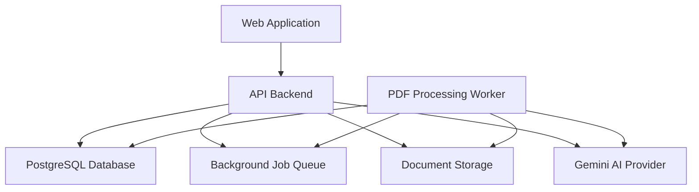
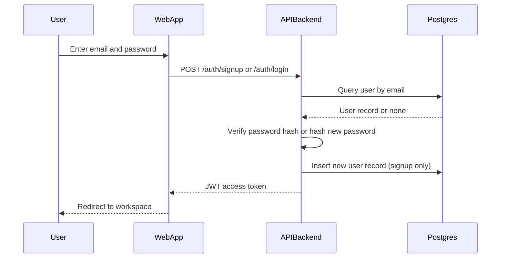
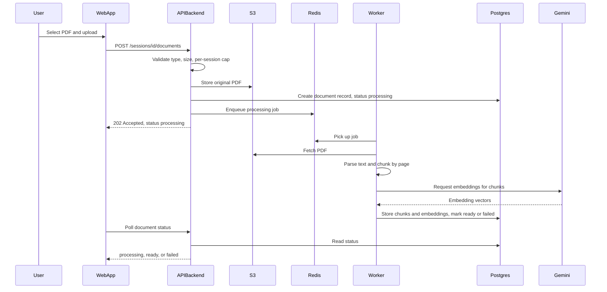
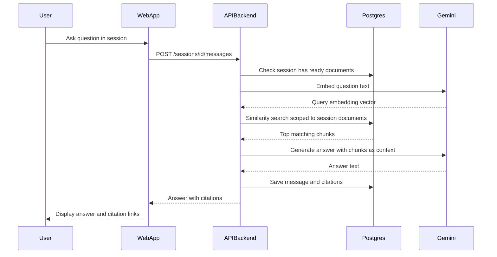
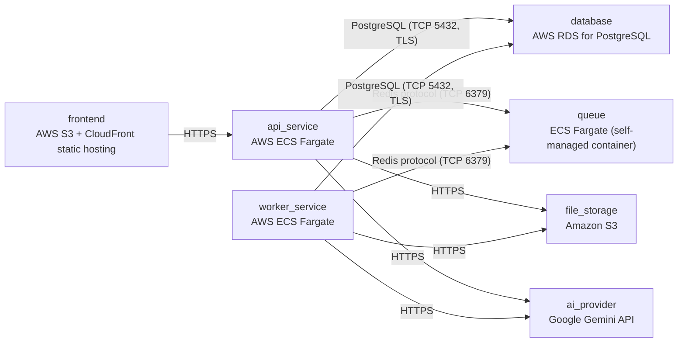

# Architecture

> Maintained by QuorQ AI SDLC. Text between `sdlc:auto` markers is regenerated; anything outside them is yours and is kept.

<!-- sdlc:auto:start narrative -->
## Overview

### ARCH-OVERVIEW · approved · source: architecture:summary

Overall approved architecture for a RAG chatbot letting authenticated users attach PDFs to chat sessions and ask questions answered only from that session's documents.

Version 1, status approved. React 19 SPA calls a FastAPI 0.115 backend that issues JWTs, stores PDFs in S3, and persists users/sessions/documents/chunks/messages in PostgreSQL 16 with pgvector. PDF parsing/chunking/embedding is offloaded to a Redis-queued background worker. Gemini gemini-embedding-001 produces embeddings and gemini-2.5-flash generates grounded answers with citations to source PDF pages. Entire stack deployed on AWS.

- ⚠ Input does not map this architecture to specific requirement IDs (US-001..US-011); traceability from requirements to architecture elements is not explicit.

### ARCH-COMPONENT-web_app · approved · source: architecture:components:web_app

React 19 single-page application providing sign-up/login, session list, PDF upload, chat window with streaming answers, and citation display.

Component: Web Application (React 19). Responsible for sign-up/login UI, session list, PDF upload flow, chat window with streaming answers, and citation display.

### ARCH-COMPONENT-api_backend · approved · source: architecture:components:api_backend

FastAPI 0.115 backend handling auth, CRUD, upload validation, job enqueueing, retrieval orchestration, and Gemini calls.

Component: API Backend (FastAPI 0.115). Issues/validates JWTs, performs session/document/message CRUD, validates uploads, enqueues processing jobs, orchestrates retrieval and Gemini calls, and enforces per-user data isolation.

### ARCH-COMPONENT-worker · approved · source: architecture:components:worker

Background worker (RQ over Redis) that performs PDF parsing, chunking, embedding, and persistence.

Component: PDF Processing Worker (Python/FastAPI ecosystem, RQ, consuming Redis). Consumes queued jobs, downloads the PDF from S3, extracts text with page positions, chunks text, calls Gemini for embeddings, writes chunks/embeddings to Postgres, and marks the document ready or failed.

### ARCH-COMPONENT-postgres · approved · source: architecture:components:postgres

PostgreSQL 16 with pgvector stores all relational data plus chunk embeddings and serves per-session similarity search.

Component: PostgreSQL Database (PostgreSQL 16 with pgvector extension). Stores users, sessions, documents, chunk text and embeddings, messages and citations; serves per-session similarity search via pgvector.

### ARCH-COMPONENT-redis · approved · source: architecture:components:redis

Redis 7 job queue decouples PDF upload requests from asynchronous processing.

Component: Background Job Queue (Redis 7, redis:7-alpine, container). Buffers PDF processing jobs so upload requests return immediately while parsing/chunking/embedding happen asynchronously.

### ARCH-COMPONENT-s3 · approved · source: architecture:components:s3

Amazon S3 durably stores original uploaded PDFs for re-parsing and citation source display.

Component: Document Storage (Amazon S3). Durable storage of original uploaded PDFs, retrievable for re-parsing and citation source display.

### ARCH-COMPONENT-gemini · approved · source: architecture:components:gemini

Google Gemini API provides embeddings and grounded chat answer generation.

Component: Gemini AI Provider (Google Gemini API, SaaS). Generates chunk/query embeddings via gemini-embedding-001 and grounded chat answers via gemini-2.5-flash.

### ARCH-CRITICALPATH-auth · approved · source: architecture:critical_paths:User Authentication

Email/password sign-up and login flow issuing a JWT.

Critical path: User Authentication. Email/password sign-up and login issuing a JWT, with hashed password storage and generic failure messaging to avoid leaking account existence.

- ⚠ Not explicitly linked to a specific requirement ID in the input.

### ARCH-CRITICALPATH-upload · approved · source: architecture:critical_paths:PDF Upload and Processing Pipeline

End-to-end pipeline from validated PDF upload through storage, queuing, parsing, chunking, and embedding.

Critical path: PDF Upload and Processing Pipeline. A validated PDF is stored in S3, queued, then parsed, chunked, embedded via Gemini, and persisted with page-level position for later retrieval.

- ⚠ Not explicitly linked to a specific requirement ID in the input.

### ARCH-CRITICALPATH-rag · approved · source: architecture:critical_paths:Retrieval-Augmented Question Answering

Question answering flow scoped strictly to the active session's ready documents, with citations.

Critical path: Retrieval-Augmented Question Answering. The question is embedded, similarity search is scoped strictly to the active session's ready documents, and an answer is generated with citations.

- ⚠ Not explicitly linked to a specific requirement ID in the input.

### ARCH-DATA-MODEL · approved · source: architecture:entities

Relational schema covering users, sessions, documents, chunks, messages, and citations.

Entities: users(id, email, password_hash, created_at); sessions(id, user_id, name, created_at); documents(id, session_id, user_id, filename, s3_key, size_bytes, page_count, status, error_message, created_at); document_chunks(id, document_id, session_id, chunk_index, page_number, content, embedding, created_at); messages(id, session_id, role, content, created_at); citations(id, message_id, document_id, chunk_id, page_number, snippet).

### ARCH-API-ENDPOINTS · approved · source: architecture:endpoints

REST API surface covering auth, session, document, and message operations.

Endpoints: POST /auth/signup (create account, enforcing complexity and uniqueness); POST /auth/login (authenticate, issue JWT); POST /auth/logout (invalidate token); GET /sessions (list own sessions); POST /sessions (create session); GET /sessions/{session_id} (get session, owner-scoped); POST /sessions/{session_id}/documents (upload PDF, validated for type/size/per-session cap, queued); GET /sessions/{session_id}/documents (list documents with processing status); POST /sessions/{session_id}/messages (ask question scoped to session's ready documents, get answer with citations); GET /sessions/{session_id}/messages (retrieve full chronological chat history).

### ARCH-DEPLOYMENT · approved · source: architecture:deployment_nodes

AWS deployment topology spanning static hosting, ECS Fargate services, RDS, and the Gemini SaaS API.

Deployment nodes: frontend (AWS S3 + CloudFront, React 19 production build); api_service (AWS ECS Fargate, FastAPI 0.115 on Uvicorn); worker_service (AWS ECS Fargate, RQ background worker); database (AWS RDS for PostgreSQL 16 with pgvector enabled); queue (ECS Fargate self-managed container, redis:7-alpine); file_storage (Amazon S3, managed); ai_provider (Google Gemini API, gemini-2.5-flash, gemini-embedding-001).

### ARCH-TECHDECISION-backend · approved · source: architecture:technology_decisions:Backend

FastAPI 0.115 chosen over Flask/Django REST Framework for async concurrency.

Decision: FastAPI 0.115 (alternatives considered: Flask, Django REST Framework). Rationale: async endpoints let one user's long-running Gemini generation call not block another user's upload request, which matters once the worker and API share the same event-loop-friendly ecosystem.

### ARCH-TECHDECISION-frontend · approved · source: architecture:technology_decisions:Frontend

React 19 chosen over Vue/Svelte for composable stateful UI and streaming/PDF ecosystem.

Decision: React 19 (alternatives considered: Vue, Svelte). Rationale: the session sidebar, streaming chat window, and citation popovers are naturally expressed as composable, stateful components, and React's ecosystem has mature streaming-fetch and PDF-rendering libraries.

### ARCH-TECHDECISION-database · approved · source: architecture:technology_decisions:Database

PostgreSQL 16 with pgvector chosen over MongoDB+vector DB or MySQL to keep relational and vector data transactionally consistent.

Decision: PostgreSQL 16 (alternatives considered: MongoDB + separate vector DB, MySQL). Rationale: relational tables for users/sessions/documents/messages and pgvector columns for chunk embeddings live in one transactional system, so a document's status and its embeddings are never out of sync.

### ARCH-TECHDECISION-cloud · approved · source: architecture:technology_decisions:Cloud

AWS chosen over GCP/Azure to consolidate storage, compute, and database under one provider.

Decision: AWS (alternatives considered: GCP, Azure). Rationale: S3 holds the original PDFs, RDS runs Postgres, and ECS Fargate runs the API, worker and Redis container, giving one provider for storage, compute and database at this scale.
<!-- sdlc:auto:end narrative -->

<!-- sdlc:auto:start building-blocks -->
## Building Block View

| ID | Name | Technology | Responsibility | Depends on |
|---|---|---|---|---|
| web_app | Web Application | React 19 | React SPA for sign-up/login, session list, PDF upload, chat window with streaming answers, and citation display | api_backend |
| api_backend | API Backend | FastAPI 0.115 | Auth (JWT issuance/validation), session/document/message CRUD, upload validation, enqueues processing jobs, orchestrates retrieval and Gemini calls, enforces per-user data isolation | postgres, redis, s3, gemini |
| worker | PDF Processing Worker | Python (FastAPI ecosystem) background worker using RQ, consuming Redis | Consumes queued jobs, downloads PDF from S3, extracts text with page positions, chunks text, calls Gemini for embeddings, writes chunks/embeddings to Postgres, marks document ready/failed | postgres, redis, s3, gemini |
| postgres | PostgreSQL Database | PostgreSQL 16 with pgvector extension | Stores users, sessions, documents, chunk text and embeddings, messages and citations; serves per-session similarity search via pgvector | — |
| redis | Background Job Queue | Redis 7 (redis:7-alpine, container) | Buffers PDF processing jobs so upload requests return immediately while parsing/chunking/embedding happens asynchronously | — |
| s3 | Document Storage | Amazon S3 | Durable storage of original uploaded PDFs, retrievable for re-parsing and citation source display | — |
| gemini | Gemini AI Provider | Google Gemini API (SaaS) | Generates chunk/query embeddings (gemini-embedding-001) and grounded chat answers (gemini-2.5-flash) | — |

<!-- sdlc:auto:end building-blocks -->

<!-- sdlc:auto:start runtime -->
## Runtime View

### User Authentication

Email/password sign-up and login issuing a JWT, with hashed password storage and generic failure messaging

- **Components:** web_app, api_backend, postgres
- **Modules:** auth_router, auth_service, password_hashing, jwt_utils
- **Key functions:** signup(email, password), login(email, password), hash_password(password), verify_password(password, hash), create_access_token(user_id), verify_token(token)

### PDF Upload and Processing Pipeline

Validated PDF is stored in S3, queued, then parsed, chunked, embedded via Gemini, and persisted with page-level position for later retrieval

- **Components:** web_app, api_backend, s3, redis, worker, postgres, gemini
- **Modules:** upload_router, document_service, s3_client, pdf_parser, chunker, embedding_client, job_queue
- **Key functions:** upload_pdf(session_id, file), validate_pdf(file, session_id), enqueue_processing_job(document_id), parse_pdf(s3_key), chunk_text(pages), embed_chunks(chunks), store_chunks(document_id, chunks, embeddings), mark_status(document_id, status, error)

### Retrieval-Augmented Question Answering

Question embedded, similarity search scoped strictly to the active session's ready documents, answer generated with citations

- **Components:** web_app, api_backend, postgres, gemini
- **Modules:** chat_router, retrieval_service, embedding_client, gemini_client, citation_builder
- **Key functions:** ask_question(session_id, question), embed_query(question), similarity_search(session_id, query_vector, top_k), generate_answer(question, chunks), build_citations(chunks), save_message(session_id, role, content, citations)

<!-- sdlc:auto:end runtime -->

<!-- sdlc:auto:start deployment-view -->
## Deployment View

| Name | Service | Runtime | Scaling | Environment |
|---|---|---|---|---|
| frontend | AWS S3 + CloudFront static hosting | React 19 production build | CDN edge caching, no server scaling needed | dev |
| api_service | AWS ECS Fargate | FastAPI 0.115 on Uvicorn | 1 task for dev, autoscale on CPU for staging/prod | dev |
| worker_service | AWS ECS Fargate | RQ background worker (Python, FastAPI ecosystem) | 1 task for dev, autoscale on Redis queue depth | dev |
| database | AWS RDS for PostgreSQL | PostgreSQL 16 with pgvector extension enabled | single db.t4g.micro instance for dev | dev |
| queue | ECS Fargate (self-managed container) | redis:7-alpine | single instance for dev | dev |
| file_storage | Amazon S3 | object storage, managed | managed by AWS | dev |
| ai_provider | Google Gemini API | gemini-2.5-flash, gemini-embedding-001 | managed by Google | dev |

| Source | Target | Protocol |
|---|---|---|
| frontend | api_service | HTTPS |
| api_service | database | PostgreSQL (TCP 5432, TLS) |
| api_service | queue | Redis protocol (TCP 6379) |
| api_service | file_storage | HTTPS |
| api_service | ai_provider | HTTPS |
| worker_service | queue | Redis protocol (TCP 6379) |
| worker_service | database | PostgreSQL (TCP 5432, TLS) |
| worker_service | file_storage | HTTPS |
| worker_service | ai_provider | HTTPS |

<!-- sdlc:auto:end deployment-view -->

<!-- sdlc:auto:start decisions -->
## Architecture Decisions

| Layer | Choice | ADR |
|---|---|---|
| Backend | FastAPI 0.115 | [ADR-0001](adr/backend.md) |
| Frontend | React 19 | [ADR-0002](adr/frontend.md) |
| Database | PostgreSQL 16 | [ADR-0003](adr/database.md) |
| Cloud | AWS | [ADR-0004](adr/cloud.md) |
<!-- sdlc:auto:end decisions -->

<!-- sdlc:auto:start links -->
## Related Documents

- [Data Model](data-model.md)
- [API Specification](api/openapi.yaml)
- [Architecture Decision Records](adr/README.md)
<!-- sdlc:auto:end links -->
