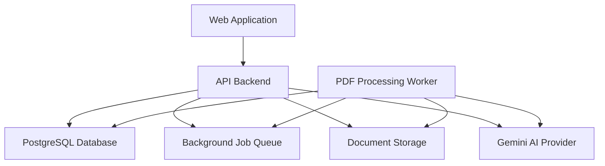
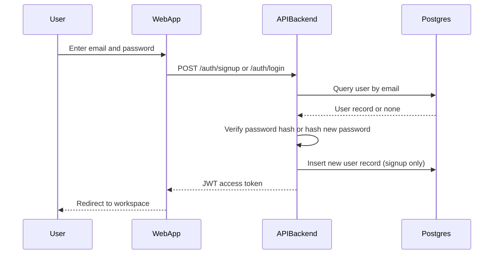
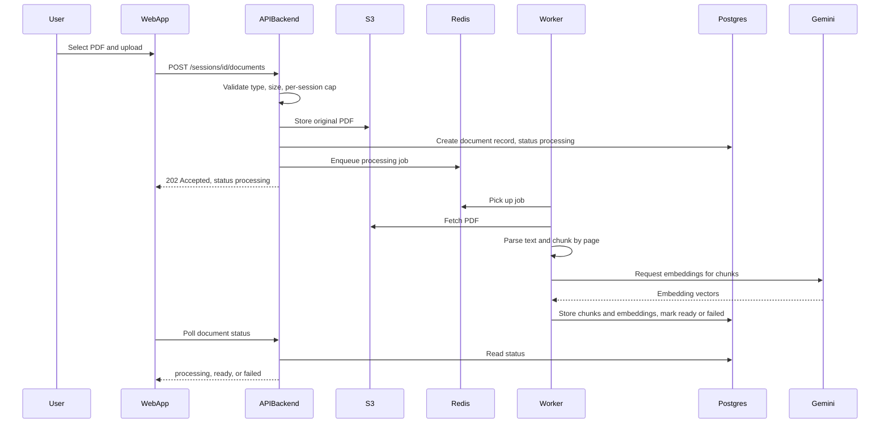
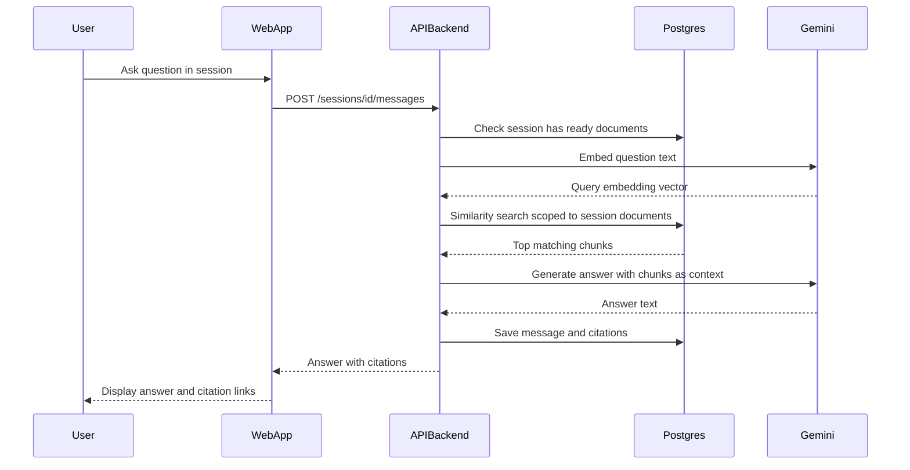
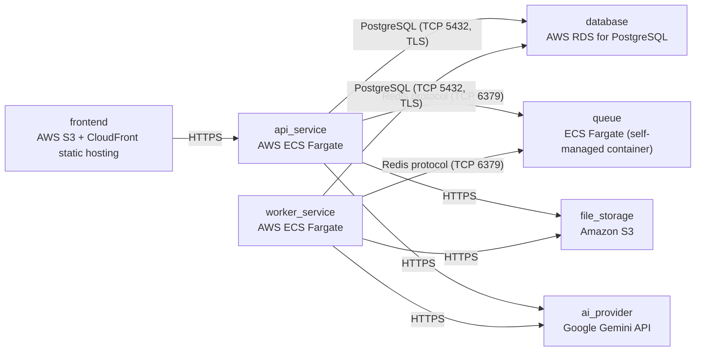

# Architecture

> Maintained by QuorQ AI SDLC. Text between `sdlc:auto` markers is regenerated; anything outside them is yours and is kept.

<!-- sdlc:auto:start narrative -->
## Overview

### ARCH-OVERVIEW · approved · source: architecture:summary

Lightweight RAG chatbot: React SPA + FastAPI backend + Postgres/pgvector + Redis worker + S3 + Gemini, on AWS.

Version 1, approved. Authenticated users create sessions, attach PDFs, and ask questions answered only from that session's documents. FastAPI issues JWTs, stores PDFs in S3, persists users/sessions/documents/chunks/messages in Postgres 16 with pgvector, offloads parsing/chunking/embedding to a Redis-queued worker. gemini-embedding-001 produces embeddings; gemini-2.5-flash generates grounded answers with citations to source PDF pages.

**Related:** EPIC-001, EPIC-002, EPIC-003, EPIC-004, EPIC-005

### ARCH-WEB-APP · approved · source: architecture:web_app

React 19 SPA for auth, session list, PDF upload, chat window, and citations.

Component: Web Application (React 19). Provides sign-up/login, session list, PDF upload, chat window with streaming answers, and citation display. Deployed as a production build to AWS S3 + CloudFront.

**Related:** EPIC-001, EPIC-002, EPIC-003, EPIC-004, EPIC-005

### ARCH-API-BACKEND · approved · source: architecture:api_backend

FastAPI backend handles auth, CRUD, upload validation, job enqueue, and orchestrates retrieval/Gemini calls.

Component: API Backend (FastAPI 0.115). Responsibilities: JWT issuance/validation, session/document/message CRUD, upload validation, enqueuing processing jobs, orchestrating retrieval and Gemini calls, enforcing per-user data isolation. Deployed on AWS ECS Fargate (Uvicorn). Endpoints: POST /auth/signup, POST /auth/login, POST /auth/logout, GET /sessions, POST /sessions, GET /sessions/{session_id}, POST /sessions/{session_id}/documents, GET /sessions/{session_id}/documents, POST /sessions/{session_id}/messages, GET /sessions/{session_id}/messages.

**Related:** EPIC-001, EPIC-002, EPIC-003, EPIC-004, EPIC-005

### ARCH-WORKER · approved · source: architecture:worker

Background RQ worker consumes Redis jobs to parse, chunk, embed, and store PDF content.

Component: PDF Processing Worker (Python/RQ, consumes Redis). Downloads PDF from S3, extracts text with page positions, chunks text, calls Gemini for embeddings, writes chunks/embeddings to Postgres, marks document ready/failed. Deployed on AWS ECS Fargate.

**Related:** EPIC-003

### ARCH-POSTGRES · approved · source: architecture:postgres

PostgreSQL 16 with pgvector stores all relational data and chunk embeddings for similarity search.

Component: PostgreSQL Database (16 + pgvector). Stores users, sessions, documents, chunk text/embeddings, messages, and citations; serves per-session similarity search. Entities: users(id,email,password_hash,created_at); sessions(id,user_id,name,created_at); documents(id,session_id,user_id,filename,s3_key,size_bytes,page_count,status,error_message,created_at); document_chunks(id,document_id,session_id,chunk_index,page_number,content,embedding,created_at); messages(id,session_id,role,content,created_at); citations(id,message_id,document_id,chunk_id,page_number,snippet). Deployed on AWS RDS for PostgreSQL.

**Related:** EPIC-001, EPIC-002, EPIC-003, EPIC-004, EPIC-005

### ARCH-REDIS · approved · source: architecture:redis

Redis buffers PDF processing jobs so uploads return immediately.

Component: Background Job Queue (Redis 7, redis:7-alpine container). Decouples upload request latency from parsing/chunking/embedding, which runs asynchronously. Deployed as a self-managed container on ECS Fargate.

**Related:** EPIC-003

### ARCH-S3 · approved · source: architecture:s3

S3 durably stores original uploaded PDFs for re-parsing and citation display.

Component: Document Storage (Amazon S3). Keeps original PDFs separate from Postgres so the database isn't carrying large binaries; files are retrievable for re-parsing and citation source display.

**Related:** EPIC-003, EPIC-004

### ARCH-GEMINI · approved · source: architecture:gemini

Google Gemini API provides embeddings and grounded chat generation.

Component: Gemini AI Provider (SaaS). gemini-embedding-001 generates chunk/query embeddings; gemini-2.5-flash generates grounded chat answers. One GEMINI_API_KEY covers both calls.

**Related:** EPIC-003, EPIC-004

### ARCH-CP-AUTH · approved · source: architecture:critical_paths

Critical path: email/password sign-up and login issuing a JWT.

Hashed password storage; generic failure messaging on invalid login to avoid leaking account existence.

**Related:** EPIC-001

### ARCH-CP-UPLOAD · approved · source: architecture:critical_paths

Critical path: validated PDF upload, storage, queuing, parsing, chunking, embedding.

Validated PDF stored in S3, queued via Redis, then parsed/chunked/embedded via Gemini and persisted with page-level position for later retrieval.

**Related:** EPIC-003

### ARCH-CP-RAG · approved · source: architecture:critical_paths

Critical path: retrieval-augmented question answering with citations.

Question embedded, similarity search scoped strictly to the active session's ready documents, answer generated with citations back to source chunks.

**Related:** EPIC-004

### ARCH-TECH-DECISIONS · approved · source: architecture:technology_decisions

Approved stack: FastAPI 0.115, React 19, PostgreSQL 16 (+pgvector), AWS.

Backend FastAPI 0.115 (vs Flask, Django REST Framework): async endpoints prevent one user's Gemini call blocking another's upload. Frontend React 19 (vs Vue, Svelte): composable stateful components fit session sidebar, streaming chat, citation popovers; mature streaming-fetch/PDF-rendering ecosystem. Database PostgreSQL 16 (vs MongoDB+separate vector DB, MySQL): relational tables plus pgvector columns in one transactional system keep document status and embeddings in sync. Cloud AWS (vs GCP, Azure): S3 for PDFs, RDS for Postgres, ECS Fargate for API/worker/Redis -- one provider for storage, compute, database at this scale.
<!-- sdlc:auto:end narrative -->

<!-- sdlc:auto:start building-blocks -->
## Building Block View

| ID | Name | Technology | Responsibility | Depends on |
|---|---|---|---|---|
| web_app | Web Application | React 19 | React SPA for sign-up/login, session list, PDF upload, chat window with streaming answers, and citation display | api_backend |
| api_backend | API Backend | FastAPI 0.115 | Auth (JWT issuance/validation), session/document/message CRUD, upload validation, enqueues processing jobs, orchestrates retrieval and Gemini calls, enforces per-user data isolation | postgres, redis, s3, gemini |
| worker | PDF Processing Worker | Python (FastAPI ecosystem) background worker using RQ, consuming Redis | Consumes queued jobs, downloads PDF from S3, extracts text with page positions, chunks text, calls Gemini for embeddings, writes chunks/embeddings to Postgres, marks document ready/failed | postgres, redis, s3, gemini |
| postgres | PostgreSQL Database | PostgreSQL 16 with pgvector extension | Stores users, sessions, documents, chunk text and embeddings, messages and citations; serves per-session similarity search via pgvector | — |
| redis | Background Job Queue | Redis 7 (redis:7-alpine, container) | Buffers PDF processing jobs so upload requests return immediately while parsing/chunking/embedding happens asynchronously | — |
| s3 | Document Storage | Amazon S3 | Durable storage of original uploaded PDFs, retrievable for re-parsing and citation source display | — |
| gemini | Gemini AI Provider | Google Gemini API (SaaS) | Generates chunk/query embeddings (gemini-embedding-001) and grounded chat answers (gemini-2.5-flash) | — |

<!-- sdlc:auto:end building-blocks -->

<!-- sdlc:auto:start runtime -->
## Runtime View

### User Authentication

Email/password sign-up and login issuing a JWT, with hashed password storage and generic failure messaging

- **Components:** web_app, api_backend, postgres
- **Modules:** auth_router, auth_service, password_hashing, jwt_utils
- **Key functions:** signup(email, password), login(email, password), hash_password(password), verify_password(password, hash), create_access_token(user_id), verify_token(token)

### PDF Upload and Processing Pipeline

Validated PDF is stored in S3, queued, then parsed, chunked, embedded via Gemini, and persisted with page-level position for later retrieval

- **Components:** web_app, api_backend, s3, redis, worker, postgres, gemini
- **Modules:** upload_router, document_service, s3_client, pdf_parser, chunker, embedding_client, job_queue
- **Key functions:** upload_pdf(session_id, file), validate_pdf(file, session_id), enqueue_processing_job(document_id), parse_pdf(s3_key), chunk_text(pages), embed_chunks(chunks), store_chunks(document_id, chunks, embeddings), mark_status(document_id, status, error)

### Retrieval-Augmented Question Answering

Question embedded, similarity search scoped strictly to the active session's ready documents, answer generated with citations

- **Components:** web_app, api_backend, postgres, gemini
- **Modules:** chat_router, retrieval_service, embedding_client, gemini_client, citation_builder
- **Key functions:** ask_question(session_id, question), embed_query(question), similarity_search(session_id, query_vector, top_k), generate_answer(question, chunks), build_citations(chunks), save_message(session_id, role, content, citations)

<!-- sdlc:auto:end runtime -->

<!-- sdlc:auto:start deployment-view -->
## Deployment View

| Name | Service | Runtime | Scaling | Environment |
|---|---|---|---|---|
| frontend | AWS S3 + CloudFront static hosting | React 19 production build | CDN edge caching, no server scaling needed | dev |
| api_service | AWS ECS Fargate | FastAPI 0.115 on Uvicorn | 1 task for dev, autoscale on CPU for staging/prod | dev |
| worker_service | AWS ECS Fargate | RQ background worker (Python, FastAPI ecosystem) | 1 task for dev, autoscale on Redis queue depth | dev |
| database | AWS RDS for PostgreSQL | PostgreSQL 16 with pgvector extension enabled | single db.t4g.micro instance for dev | dev |
| queue | ECS Fargate (self-managed container) | redis:7-alpine | single instance for dev | dev |
| file_storage | Amazon S3 | object storage, managed | managed by AWS | dev |
| ai_provider | Google Gemini API | gemini-2.5-flash, gemini-embedding-001 | managed by Google | dev |

| Source | Target | Protocol |
|---|---|---|
| frontend | api_service | HTTPS |
| api_service | database | PostgreSQL (TCP 5432, TLS) |
| api_service | queue | Redis protocol (TCP 6379) |
| api_service | file_storage | HTTPS |
| api_service | ai_provider | HTTPS |
| worker_service | queue | Redis protocol (TCP 6379) |
| worker_service | database | PostgreSQL (TCP 5432, TLS) |
| worker_service | file_storage | HTTPS |
| worker_service | ai_provider | HTTPS |

<!-- sdlc:auto:end deployment-view -->

<!-- sdlc:auto:start decisions -->
## Architecture Decisions

| Layer | Choice | ADR |
|---|---|---|
| Backend | FastAPI 0.115 | [ADR-0001](adr/backend.md) |
| Frontend | React 19 | [ADR-0002](adr/frontend.md) |
| Database | PostgreSQL 16 | [ADR-0003](adr/database.md) |
| Cloud | AWS | [ADR-0004](adr/cloud.md) |
<!-- sdlc:auto:end decisions -->

<!-- sdlc:auto:start links -->
## Related Documents

- [Data Model](data-model.md)
- [API Specification](api/openapi.yaml)
- [Architecture Decision Records](adr/README.md)
<!-- sdlc:auto:end links -->
