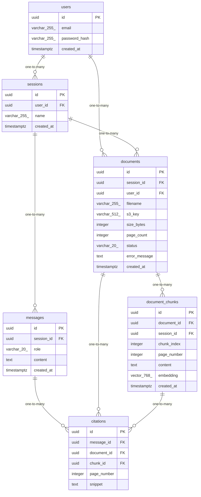

# Data Model

<!-- sdlc:auto:start entities -->
### users

| Field | Type | PK | FK | Nullable |
|---|---|---|---|---|
| id | uuid | True | — | False |
| email | varchar(255) | False | — | False |
| password_hash | varchar(255) | False | — | False |
| created_at | timestamptz | False | — | False |

### sessions

| Field | Type | PK | FK | Nullable |
|---|---|---|---|---|
| id | uuid | True | — | False |
| user_id | uuid | False | users.id | False |
| name | varchar(255) | False | — | True |
| created_at | timestamptz | False | — | False |

### documents

| Field | Type | PK | FK | Nullable |
|---|---|---|---|---|
| id | uuid | True | — | False |
| session_id | uuid | False | sessions.id | False |
| user_id | uuid | False | users.id | False |
| filename | varchar(255) | False | — | False |
| s3_key | varchar(512) | False | — | False |
| size_bytes | integer | False | — | False |
| page_count | integer | False | — | True |
| status | varchar(20) | False | — | False |
| error_message | text | False | — | True |
| created_at | timestamptz | False | — | False |

### document_chunks

| Field | Type | PK | FK | Nullable |
|---|---|---|---|---|
| id | uuid | True | — | False |
| document_id | uuid | False | documents.id | False |
| session_id | uuid | False | sessions.id | False |
| chunk_index | integer | False | — | False |
| page_number | integer | False | — | True |
| content | text | False | — | False |
| embedding | vector(768) | False | — | False |
| created_at | timestamptz | False | — | False |

### messages

| Field | Type | PK | FK | Nullable |
|---|---|---|---|---|
| id | uuid | True | — | False |
| session_id | uuid | False | sessions.id | False |
| role | varchar(20) | False | — | False |
| content | text | False | — | False |
| created_at | timestamptz | False | — | False |

### citations

| Field | Type | PK | FK | Nullable |
|---|---|---|---|---|
| id | uuid | True | — | False |
| message_id | uuid | False | messages.id | False |
| document_id | uuid | False | documents.id | False |
| chunk_id | uuid | False | document_chunks.id | True |
| page_number | integer | False | — | True |
| snippet | text | False | — | True |
<!-- sdlc:auto:end entities -->

<!-- sdlc:auto:start relationships -->
| Source | Target | Type |
|---|---|---|
| users | sessions | one-to-many |
| users | documents | one-to-many |
| sessions | documents | one-to-many |
| documents | document_chunks | one-to-many |
| sessions | messages | one-to-many |
| messages | citations | one-to-many |
| documents | citations | one-to-many |
| document_chunks | citations | one-to-many |
<!-- sdlc:auto:end relationships -->

<!-- sdlc:auto:start er-diagram -->

<!-- sdlc:auto:end er-diagram -->
