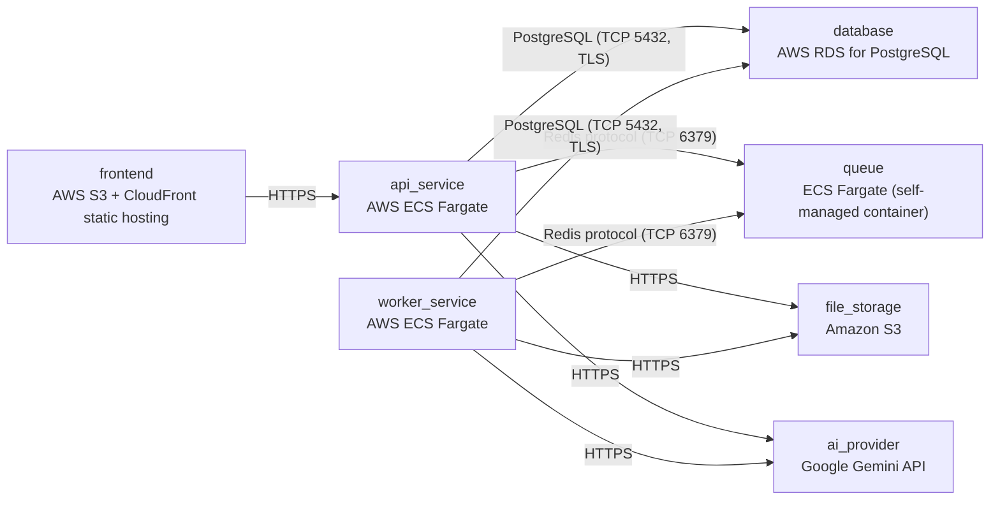

# Deployment Guide

> Maintained by QuorQ AI SDLC. Text between `sdlc:auto` markers is regenerated; anything outside them is yours and is kept.

<!-- sdlc:auto:start how-it-deploys -->
Pushes to `main` run `.github/workflows/deploy.yml`, which builds the API image (if there is a backend) and deploys the SPA to AWS Amplify. Commits touching only `docs/sdlc/**` don't deploy. Deployments can also be started from the platform's Deployment tab.
<!-- sdlc:auto:end how-it-deploys -->

<!-- sdlc:auto:start environments -->
| Name | Service | Runtime | Scaling | Environment |
|---|---|---|---|---|
| frontend | AWS S3 + CloudFront static hosting | React 19 production build | CDN edge caching, no server scaling needed | dev |
| api_service | AWS ECS Fargate | FastAPI 0.115 on Uvicorn | 1 task for dev, autoscale on CPU for staging/prod | dev |
| worker_service | AWS ECS Fargate | RQ background worker (Python, FastAPI ecosystem) | 1 task for dev, autoscale on Redis queue depth | dev |
| database | AWS RDS for PostgreSQL | PostgreSQL 16 with pgvector extension enabled | single db.t4g.micro instance for dev | dev |
| queue | ECS Fargate (self-managed container) | redis:7-alpine | single instance for dev | dev |
| file_storage | Amazon S3 | object storage, managed | managed by AWS | dev |
| ai_provider | Google Gemini API | gemini-2.5-flash, gemini-embedding-001 | managed by Google | dev |
<!-- sdlc:auto:end environments -->

<!-- sdlc:auto:start live -->
_Not deployed yet._
<!-- sdlc:auto:end live -->

<!-- sdlc:auto:start topology -->

<!-- sdlc:auto:end topology -->
